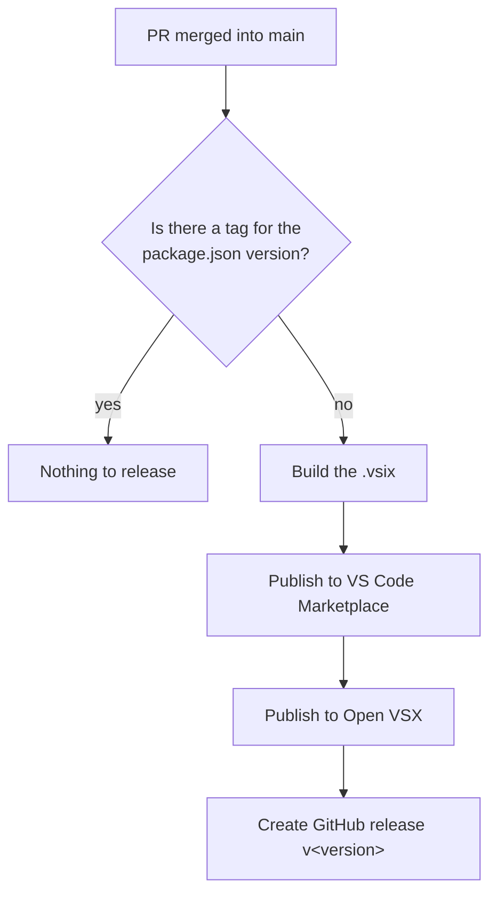

# Contributing

You'll need [Node.js](https://nodejs.org/) 20 or newer and git.

## Build and run

```sh
git clone https://github.com/nahueltaibo/vscode-3d-viewer.git
cd vscode-3d-viewer
npm install
npm run watch
```

Press F5 to launch an Extension Development Host with the extension loaded.

- `src/extension.ts` registers the custom editors, reads model files and watches them for changes.
- `src/webview/main.js` runs the Online3DViewer engine inside the webview.
- `src/webview/viewcube.js` draws the view cube and turns clicks on it into camera directions.
- `src/webview/parts.js` builds the part tree from the model's nodes and drives per-part visibility and highlighting.
- `src/webview/occt.js` loads the bundled Open CASCADE build for STEP, IGES, BREP and FCStd. `esbuild.mjs` points the engine at it instead of the CDN.

## Install your build

`npm run package` type-checks, builds a production bundle and writes `o3dv-viewer-<version>.vsix`. Install it with:

```sh
code --install-extension o3dv-viewer-<version>.vsix --force
```

Then run **Developer: Reload Window**. Tabs that were already open keep the old viewer until you reopen them.

## Release

Releases happen when a PR merges into `main`:



To ship a change, bump `version` in `package.json` and add a matching `## <version>` section to `CHANGELOG.md` in the same PR. That section becomes the release notes. CI builds every PR and says whether merging it will publish.

The README is the listing on both stores. It loads `docs/screenshot.png` from `main`, so a new screenshot shows up once it merges, without a release. Keep the README about using the extension and put build details here.

The workflow needs two repository secrets: `VSCE_PAT` (Azure DevOps token, Marketplace → Manage scope) and `OVSX_PAT` (Open VSX token). To release without a PR, run the **Release** workflow by hand from the Actions tab.
