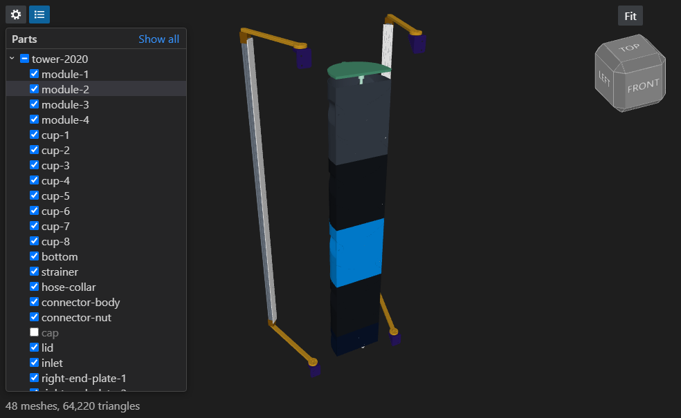

# 3D Model Viewer for VS Code

Open STEP, STL, 3MF and other 3D models in a VS Code tab instead of switching to a separate app. Keep the tab open while your CAD script rebuilds the file, and the view refreshes without losing your camera.

Rendering and import come from [Online3DViewer](https://github.com/kovacsv/Online3DViewer). Everything runs offline inside VS Code.



## Prerequisites

- **VS Code 1.90 or newer.** Desktop on Windows, macOS or Linux. Remote SSH, WSL and Dev Containers work too, because the extension reads files through VS Code.
- **A GPU with WebGL 2 support.** Any machine from the last decade qualifies.
- **Building from source only:** [Node.js](https://nodejs.org/) 20 or newer (npm comes with it) and git.

## Install

**From the extension store.** This is the easiest way. Open the Extensions view, search for **3D Model Viewer (Online3DViewer)** and click **Install**. You can also install it from the command line:

```sh
code --install-extension nahueltaibo.o3dv-viewer
```

It's listed on the [VS Code Marketplace](https://marketplace.visualstudio.com/items?itemName=nahueltaibo.o3dv-viewer) and on [Open VSX](https://open-vsx.org/extension/nahueltaibo/o3dv-viewer) for VSCodium, Cursor and other VS Code forks.

**From a release.** Use this when the store isn't available, such as on an offline machine.

1. Download the latest `.vsix` from the [Releases page](https://github.com/nahueltaibo/vscode-3d-viewer/releases/latest).
2. Install it, either from a terminal:

   ```sh
   code --install-extension o3dv-viewer-0.3.0.vsix
   ```

   or in VS Code: open the Extensions view, click the `…` menu and pick **Install from VSIX…**.
3. Run **Developer: Reload Window**. Tabs that were already open keep their old editor until you reopen them.

**From source.**

```sh
git clone https://github.com/nahueltaibo/vscode-3d-viewer.git
cd vscode-3d-viewer
npm install
npm run package
code --install-extension o3dv-viewer-0.3.0.vsix
```

## Use it

Open a model from the Explorer. Most formats open in the viewer straight away:

- **Open in the viewer by default:** STEP, IGES, BREP, FCStd, STL, 3MF, GLB, 3DS, FBX, PLY, AMF.
- **Opt-in:** OBJ, OFF, glTF, DAE, WRL, BIM. These are text formats, so the text editor stays the default. Right-click the tab and pick **Reopen Editor With… → 3D Model Viewer**.

To make the viewer the default for a text format, add this to your settings:

```json
"workbench.editorAssociations": { "*.obj": "o3dv.viewer.text" }
```

**Mouse controls:** left-drag orbits, right-drag pans and the wheel zooms.

**Toolbar:**

| Button | What it does |
|---|---|
| Fit | Frames the whole model. |
| Turn | Turns the view 180° around the up axis, to see the other side. |
| Y up / Z up | Switches the up axis. The starting axis comes from the `o3dv.upAxis` setting. |
| Edges | Draws feature edges on top of the shaded model. |
| Persp / Ortho | Switches between perspective and orthographic projection. |

**Live reload.** When the file changes on disk, the model reloads and keeps your camera. If the file changes again mid-load, only the newest version is loaded.

**STEP and other CAD formats.** STEP, IGES, BREP and FCStd go through a bundled WebAssembly build of Open CASCADE. The import runs in a background worker, so the UI stays responsive. A 17 MB STEP assembly takes a few seconds.

**Companion files.** OBJ, glTF, 3DS, DAE, FBX and WRL can reference other files. The viewer loads `.mtl`, `.bin` and texture files from the same folder. Any it still can't find show in the status line at the bottom.

## Settings

| Setting | Default | What it does |
|---|---|---|
| `o3dv.upAxis` | `auto` | Up axis for new views. `auto` uses Z for STEP, IGES and BREP, which CAD tools export Z-up. Everything else uses Y, because the importer already turns Z-up mesh formats like STL and 3MF into Y-up. |
| `o3dv.defaultView` | `front` | Side the camera starts on. `front` matches the CAD front view, looking from −Y for Z-up models. Use `back` if your models face +Y. |
| `o3dv.showEdges` | `false` | Draws feature edges when a model opens. |
| `o3dv.edgeThreshold` | `30` | Minimum angle between faces, in degrees, for an edge to be drawn. |

## Not supported yet

3DM, IFC and Draco-compressed glTF. Online3DViewer loads the libraries for these from a CDN, and this extension doesn't bundle them yet.

## Development

```sh
npm install
npm run watch
```

Press F5 to launch an Extension Development Host with the extension loaded.

- `src/extension.ts` registers the custom editors, reads model files and watches them for changes.
- `src/webview/main.js` runs the Online3DViewer engine inside the webview.
- `src/webview/occt.js` loads the bundled Open CASCADE build for STEP, IGES, BREP and FCStd. `esbuild.mjs` points the engine at it instead of the CDN.
- `npm run package` type-checks, builds a production bundle and writes the `.vsix`.

## License

MIT. The bundled Open CASCADE build is LGPL 2.1. All third-party licenses are in [THIRD_PARTY_NOTICES.md](THIRD_PARTY_NOTICES.md).
